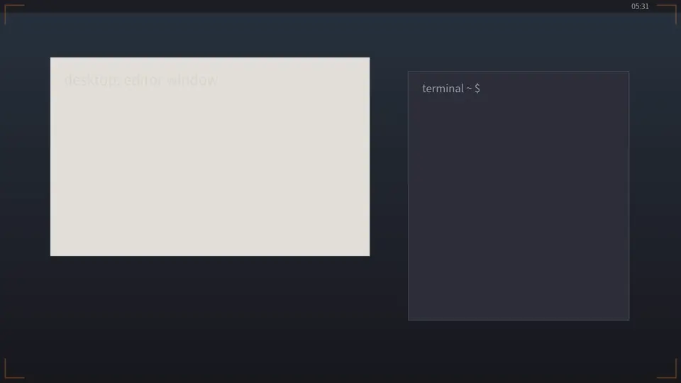
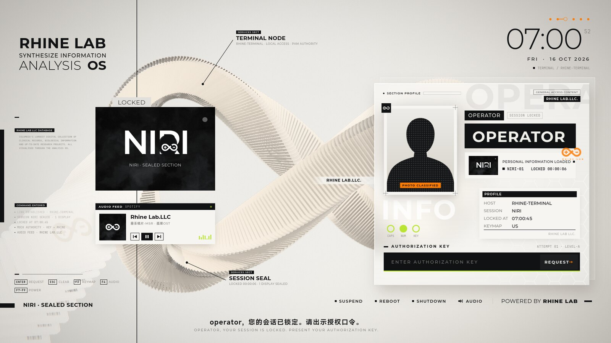
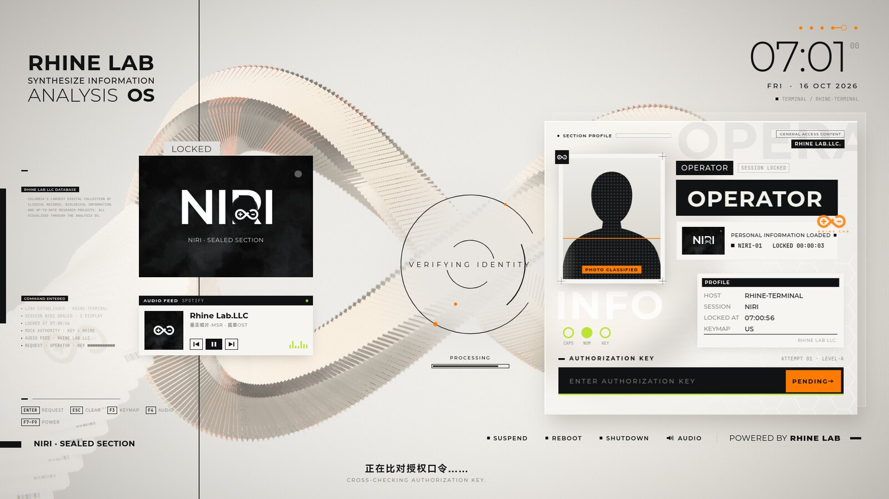
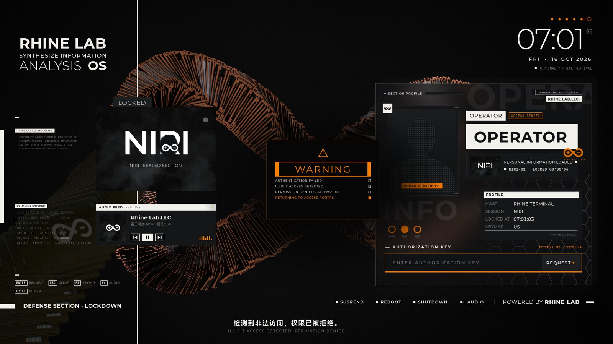

# rhine-lock

[English](README.md) · **简体中文**

[](https://github.com/tmc5csxr9m-cpu/rhine-lock/actions/workflows/build.yml)

一个《明日方舟》**莱茵生命**风格的 Wayland 锁屏：实时渲染的 3D ∞ 亚克力卡片雕塑、
磨砂玻璃人员档案，以及影片终章的黑橙 WARNING 封锁。锁屏时你的桌面会缩成一张
"标本卡片"归档，解锁时它再变回你的桌面。



| 就绪 | 验证中 | 拒绝访问 |
|---|---|---|
|  |  |  |

只要合成器实现了 `ext-session-lock-v1` 就能用——niri、sway、Hyprland、river 等，
通过 PAM 认证。

> 同人作品，与鹰角网络无关，也未获其认可。《明日方舟》与"莱茵生命"是鹰角网络的
> 商标；∞ 标志为爱好者重绘。

## 工作原理

| 部分 | 技术栈 | 职责 |
|---|---|---|
| `backend/` | Rust · GTK 4 · gtk4-layer-shell · WebKitGTK 6 · PAM · zbus | 在每块显示器上获取会话锁，通过私有的 `rhine://` 协议从内存提供界面，执行 PAM 认证，并且是**唯一**能解锁的部分 |
| `frontend/` | Svelte 5 · TypeScript · Vite · Three.js | 你看到和听到的一切；它从不决定是否解锁 |
| `CONTRACT.md` | | 两者之间的消息协议 |

- **无缝进出场。** 锁屏*之前*先截下每块屏幕（用 `grim`，只放在内存里），作为锁屏
  画出的第一帧；解锁动画最后停在同一张图上，真实桌面接替的是完全相同的一帧。
  （niri 会一直显示你的桌面，直到锁屏画好；sway 可能先显示一帧它自己的黑屏。）
- **失败安全。** 界面本身什么也解不开——只有后端的 PAM 认证成功才能解锁。网页
  视图崩溃会自动重载；30 秒内崩溃三次、前端缺失、15 秒内没有握手，或页面 8 秒
  没有响应时，由原生 GTK 密码框接管——任何时候按 **Ctrl+Shift+Esc** 也能切换到
  它。卡住的 PAM 模块 60 秒后被中止，记为一次失败。Rust panic 会自动重启一次并
  直接进入原生密码框；再次 panic、原生崩溃或进程被终止时，合成器保持锁定，需要
  用户恢复（见"恢复"）。
- **如实报错。** "密码错误"和"密码已通过但被账户策略拒绝"会分开显示；
  `rhine-lock --check-pam` 不输密码就能检查 PAM 的账户与凭据配置。
- **谨慎对待口令。** 超过 4096 字节的口令会被拒绝，绝不截断；空口令从不发送
  （它只会白白计入 `pam_faillock`）；禁用核心转储，后端用完即擦除自己的副本。
- **媒体与电源。** 显示正在播放的 MPRIS 曲目并可控制；没有播放器时显示锁屏自带的
  背景音乐，可播放 / 暂停；只有 logind 无需 polkit 认证就允许时才显示睡眠、
  重启、关机，且需要分开按两次才执行。
- **声音。** 自带界面音效；背景音乐是可选的，需要你自己获取（见下文）。音乐只在
  你回到键盘前时才响起，而且不会盖过你自己正在放的音乐。

## 依赖

- 支持 `ext-session-lock-v1` 的 Wayland 合成器
- GTK ≥ 4.18、gtk4-layer-shell ≥ 1.3、WebKitGTK 6.0 ≥ 2.40、Linux-PAM
- 构建：Rust ≥ 1.92、Node.js 20.19+ 或 22.12+（含 npm）、pkg-config、C 编译器
- 可选：`grim`（无缝过渡）、`ffmpeg` + Python `numpy`（音乐）、niri（切换键盘
  布局、识别当前聚焦的显示器）、systemd-logind 或 elogind（电源操作）、
  UPower（电量）、MPRIS 播放器（媒体卡片）

| 发行版 | 构建依赖 |
|---|---|
| Arch | `sudo pacman -S --needed gtk4 gtk4-layer-shell webkitgtk-6.0 pam rust nodejs npm pkgconf grim` |
| Fedora 43+ | `sudo dnf install 'pkgconfig(gtk4)' 'pkgconfig(gtk4-layer-shell-0)' 'pkgconfig(webkitgtk-6.0)' pam-devel cargo nodejs npm grim` |
| openSUSE Tumbleweed | `sudo zypper install 'pkgconfig(gtk4)' 'pkgconfig(gtk4-layer-shell-0)' 'pkgconfig(webkitgtk-6.0)' pam-devel cargo nodejs npm grim` |
| Ubuntu 26.04+、Debian testing | `sudo apt install libgtk-4-dev libgtk4-layer-shell-dev libwebkitgtk-6.0-dev libpam0g-dev pkg-config build-essential nodejs npm grim`，Rust 用 [rustup.rs](https://rustup.rs) 安装 |

Debian 13（trixie）自带的 gtk4-layer-shell 是 1.0.4，还没有会话锁 API：请先从
源码构建 gtk4-layer-shell ≥ 1.3，或使用 Debian testing。`install.sh` 会在构建前
检查所有最低版本。

测试情况：作者在 Arch Linux + niri 上日常使用；在干净的 Fedora 43、Ubuntu 26.04、
Debian sid、openSUSE Tumbleweed 容器中完整测试了安装、PAM 自检、重复安装、回滚
和卸载；端到端测试在 sway 下驱动真实的 GTK/WebKit 锁屏窗口。

## 安装

```sh
git clone https://github.com/tmc5csxr9m-cpu/rhine-lock
cd rhine-lock
tools/fetch-bgm.py   # 可选：下载背景音乐，仅供个人使用
./install.sh         # 检查、构建、安装到 /usr/local、写入 PAM 服务并自检
```

`install.sh` 会先检查所有依赖，以你的用户身份构建，只在安装那一步请求 root
（sudo 或 doas）。它根据你的发行版自带的 PAM 栈（`common-auth`/`common-account`、
`login` 或 `system-auth`）写入 `/etc/pam.d/rhine-lock`——如果这个文件是你自己写的，
会原样保留——然后运行 `rhine-lock --check-pam`；自检失败就恢复之前的安装。它从不
修改你的合成器配置。`./install.sh --prefix /usr` 可安装到别处，
`./install.sh --uninstall` 会移除二进制和前端（使用相同的前缀）。共享的 PAM 服务会
保留，让其他安装或仍在运行的锁屏继续认证；只有两者都不再需要时，才手动移除
`/etc/pam.d/rhine-lock`。

交换文件时被中断也会回滚。并发安装或卸载，以及遗留的 `.rhine-old`/`.rhine-new`
文件都会被拒绝。如果无法捕获的中断留下了 `/etc/.rhine-lock-install.lock`，请先
恢复保留的文件，再删除该目录并重试；安装器会保留这些文件以供恢复。

然后接入合成器，例如：

```kdl
// niri — binds.kdl
Mod+Alt+L { spawn "rhine-lock" "--daemonize"; }
```
```sh
# sway
bindsym $mod+Alt+l exec rhine-lock --daemonize
# Hyprland
bind = SUPER ALT, L, exec, rhine-lock --daemonize
# swayidle — 空闲 5 分钟锁屏，睡眠前也锁屏
swayidle -w timeout 300 'rhine-lock --daemonize' \
            before-sleep 'rhine-lock --daemonize' lock 'rhine-lock --daemonize'
# hypridle — general { lock_cmd = rhine-lock --daemonize }
```

`--daemonize` 会等屏幕真正锁上才返回——另一个实例正在锁屏时也一样——所以用在
睡眠前的钩子里是安全的。

## 使用

| 按键 | 作用 |
|---|---|
| 输入口令，回车 | 认证 |
| Esc | 清空输入 / 取消待确认的电源操作 |
| Tab | 在屏幕上的按钮间移动（回车或空格按下；直接打字会回到口令框） |
| F3 | 切换到下一个键盘布局（niri） |
| F4 | 声音开 / 关 |
| F7 / F8 / F9 | 睡眠 / 重启 / 关机——按两次执行 |
| Ctrl+Shift+Esc | 切换到朴素的原生密码框 |

## 配置

`~/.config/rhine-lock/config.toml`（或 `/etc/rhine-lock/config.toml`），所有项
都可省略：

```toml
[lock]
pam_service = "rhine-lock"   # 认证使用的 PAM 服务
allow_power = true           # 是否提供重启 / 关机

[frontend]
quality = "ultra"            # ultra | high | low（low：无阴影、环境光遮蔽和景深）
music = true                 # false：背景音乐默认暂停（可在媒体卡片上播放）
music_volume = 0.68          # 感知音量，0–1
sfx_volume = 0.7             # 0–1
standby_seconds = 45         # 空闲多久进入待机，0 = 永不
```

配置文件无法读取或解析时会记录到日志，锁屏改用默认的 PAM 服务，并禁用重启和关机。

## 局限

- 锁屏模式通过 `WAYLAND_DISPLAY` 选择合成器，不接受 `WAYLAND_SOCKET` 传入的
  已连接描述符；如果启动环境设有该变量，请先取消设置 `WAYLAND_SOCKET`。
- 每次认证只有一个口令：需要更多输入的 PAM 会话（一次性验证码、第二因素、修改
  过期密码）不受支持。
- 切换键盘布局（F3）和识别聚焦的显示器需要 niri；在其他合成器上只显示布局、
  不能切换。
- 3D 场景需要 WebGL 2；没有时锁屏显示平面背景，功能完全一样。
- 口令会经过 WebKit 的 JavaScript 引擎，rhine-lock 无法擦除那部分内存。如果你在意，
  请启用磁盘和交换分区加密。

## 恢复

- **密码正确却解不开？** 在另一个终端或通过 SSH 运行 `rhine-lock --check-pam`，
  它会告诉你是 PAM 的哪一步失败了，而且不做密码验证。
- **界面卡住或出错？** 按 **Ctrl+Shift+Esc** 切换到原生密码框。
- **锁屏程序崩溃了？** Rust panic 会自动重启一次；原生崩溃或进程被终止不会自动
  重启。如果彻底退出了，合成器会刻意保持锁定：
  切到 TTY（Ctrl+Alt+F2）登录，在你的会话显示上启动一个新的锁屏——
  `WAYLAND_DISPLAY=wayland-1 rhine-lock`（套接字名用 `ls $XDG_RUNTIME_DIR` 确认）
  ——然后正常解锁。旧锁屏退出后，sway 和 niri 都允许新的锁屏客户端接管；Hyprland
  需要设置 `misc:allow_session_lock_restore = true`。

## 开发

```sh
cd frontend && npm ci && npm run dev   # 在浏览器里用模拟后端预览界面；口令是 "rhine"
```

动手之前请先读 [AGENTS.md](AGENTS.md)：永远不要在你正在使用的会话里测试锁屏
（`tools/headless.sh` 会在私有的无头合成器里运行一切），也永远不要用错误密码去
试真实账户。端到端测试（`backend/tests/e2e.sh`、`frontend/tests/input.sh`）用真实
的按键驱动真实的 GTK/WebKit 锁屏窗口，逐帧录下过渡动画并按像素比对。

后端由 OpenAI Codex 编写，前端由 Anthropic 的 Claude 编写，二者依据 `CONTRACT.md`
并行开发；发布前由 Codex 对整个项目做了深度审查，双方修复了发现的问题。

## 许可与致谢

- 代码：[GNU AGPL-3.0-or-later](LICENSE)。
- 字体：Montserrat、JetBrains Mono，SIL Open Font License 1.1
  （`frontend/public/fonts/OFL-*.txt`）。
- 界面音效：Kenney *Interface Sounds*（CC0）；开场、拼装、验证、警告等音效为本
  项目合成。每个素材的来源见 [tools/assets/README.md](tools/assets/README.md)。
- 背景音乐：「孤星」OST 中的 "Rhine Lab.LLC"，© 鹰角网络 / 塞壬唱片——**不随本项目
  分发**；`tools/fetch-bgm.py` 会为你下载，仅供个人使用。
- 视觉参考：《明日方舟》特别映像《莱茵生命：访问》。光照探针、场景纹理和合成音效
  由本仓库中的脚本生成；预览桌面是手绘的虚构图像。
